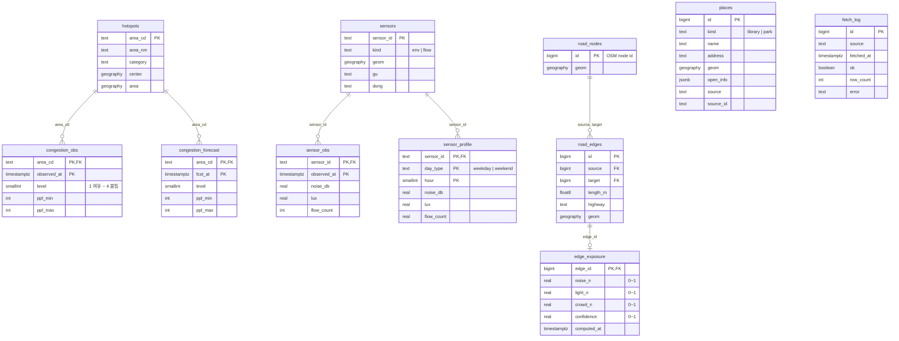

# Supabase (BE)

FE에 주는 함수의 인자와 응답 형식은 [docs/api.md](../docs/api.md)에 있습니다.

```
supabase/
├─ config.toml
├─ migrations/
│  ├─ 20261031074000_init_schema.sql  테이블 · 인덱스 · RLS
│  └─ 20261031074100_rpc_stubs.sql    계산 함수 + FE용 RPC (지금은 가짜 데이터)
└─ seed.sql
```

## DB에 적용하기

Docker 없이 원격 프로젝트에 바로 적용합니다. 처음 한 번만 로그인하고 프로젝트를 연결합니다(DB 비밀번호 필요).

```bash
npx supabase login
```

```bash
npx supabase link --project-ref oojowgovzmjlhzuqzqcp
```

적용:

```bash
npx supabase db push
```

- `db push` 전에 `git pull`로 다른 사람의 마이그레이션을 먼저 받습니다. 원격 DB에 내 로컬에 없는 마이그레이션이 있으면 push가 거부됩니다.
- 변경은 항상 새 파일로 합니다(`npx supabase migration new <이름>`). 이미 push한 파일은 고치지 않습니다.
- RPC를 실제 로직으로 바꿀 때는 새 마이그레이션에서 같은 이름·인자로 `create or replace function` 합니다. 인자를 바꾸면 FE 호출이 깨지니 [docs/api.md](../docs/api.md)도 같이 고칩니다.

## 권한

- 앱(anon·authenticated)은 테이블을 **읽기만** 합니다. 쓰기는 `service_role` 키를 쓰는 수집기만 합니다.
- `fetch_log`는 에러 메시지에 서울 API 키가 섞일 수 있어 앱에 공개하지 않습니다. `data_status()`가 요약만 돌려줍니다.
- 서울 API 키는 Edge Function 시크릿(`npx supabase secrets set SEOUL_API_KEY=...`)에만 둡니다.

## ERD

`places`·`sensors`·`hotspots`·`road_edges`는 외래키 대신 좌표(PostGIS 거리 계산)로 서로 연결됩니다.



## 남은 일

- [ ] 확장 켜기: `pgrouting`(경로), `pg_cron`·`pg_net`(수집 주기 실행). 대시보드 Database → Extensions
- [ ] 고정 데이터 적재: `hotspots`, `sensors`, `places`, osmnx 도로망(`road_nodes`, `road_edges`)
- [ ] Edge Function 수집기: `congestion_obs`, `congestion_forecast`, `sensor_obs`에 upsert하고 `fetch_log`에 기록
- [ ] IDW 보간으로 `edge_exposure` 계산
- [ ] RPC 본문을 실제 로직으로 교체(`TODO(BE)` 주석): `nearby_shelters` → `place_detail` → `map_layers` → `best_times` → `quiet_routes`
