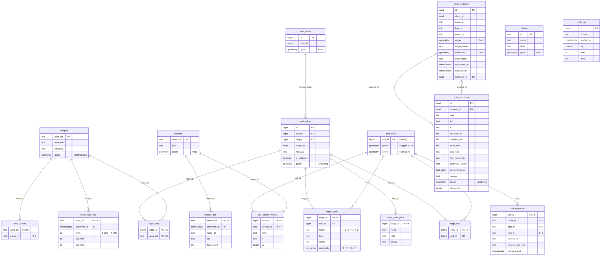

# Supabase (BE)

FE에 주는 함수의 인자와 응답 형식은 [docs/api.md](../docs/api.md)에 있습니다.

```
supabase/
├─ config.toml
├─ migrations/
│  ├─ 20261031074000_init_schema.sql  테이블 · 뷰 · RLS (원격 DB에 이미 있는 스키마를 옮겨 적은 것)
│  └─ 20261031074100_rpc_stubs.sql    계산 함수 + FE용 RPC (지금은 가짜 데이터)
└─ seed.sql
```

## DB에 적용하기

Docker 없이 원격 프로젝트에 바로 적용합니다. 처음 한 번만 로그인하고 프로젝트를 연결합니다(DB 비밀번호 필요).

```bash
npx supabase login
```

```bash
npx supabase link --project-ref oojowgovzmjlhzuqzqcp
```

테이블은 원격에 이미 만들어져 있으므로, 첫 마이그레이션은 실행하지 않고 "적용됨"으로 표시만 합니다. 처음 한 번만 합니다.

```bash
npx supabase migration repair --status applied 20261031074000
```

그다음부터는 push로 새 마이그레이션(지금은 RPC)만 적용합니다.

```bash
npx supabase db push
```

- `db push` 전에 `git pull`로 다른 사람의 마이그레이션을 먼저 받습니다. 원격 DB에 내 로컬에 없는 마이그레이션이 있으면 push가 거부됩니다.
- 변경은 항상 새 파일로 합니다(`npx supabase migration new <이름>`). 대시보드 SQL 편집기에서 직접 테이블을 바꾸면 레포와 DB가 어긋나니, 바꿨다면 같은 내용을 마이그레이션으로도 남깁니다.
- RPC를 실제 로직으로 바꿀 때는 새 마이그레이션에서 같은 이름·인자로 `create or replace function` 합니다. 인자를 바꾸면 FE 호출이 깨지니 [docs/api.md](../docs/api.md)도 같이 고칩니다.

## 권한

- 모든 테이블에 RLS가 켜져 있습니다. anon 직접 읽기는 `hotspots`, `places`, `congestion_obs`만 허용합니다. `edge_exposure`는 뷰(`security_invoker`)라 앱이 직접 읽으면 0행이고, RPC로만 읽습니다.
- 나머지 테이블을 읽는 실제 RPC는 `security definer`로 만듭니다(`data_status()` 참고). 쓰기는 `service_role` 키를 쓰는 수집기·스크립트만 합니다.
- `fetch_log`는 오류 원문에 서울 API 키가 섞일 수 있어 anon 직접 읽기를 차단합니다. 앱에는 `data_status()`가 오류 원문 없이 요약만 돌려줍니다.
- 서울 API 키는 Edge Function 시크릿(`npx supabase secrets set SEOUL_OPENAPI_KEY=...`)에만 둡니다.

## ERD

`places`·`sensors`·`hotspots`·`road_edges`는 외래키 대신 좌표(PostGIS 거리 계산)로 서로 연결됩니다. 좌표는 모두 `geometry(4326)`입니다.



`latest_congestion`은 `congestion_obs`에서 장소별 가장 최근 행만 보여주는 뷰입니다.

### 감각 노출값 (`edge_exposure` 뷰)

센서는 수백 m 간격이라 센서 값은 도로 구간마다가 아니라 250m 칸마다 계산하고, 도로 종류와 혼잡 장소는 구간마다 섞습니다.

- 10분마다 pg_cron이 `refresh_edge_exposure()`를 부릅니다. 칸별 센서 IDW(`cell_exposure`)와 혼잡 장소 인파(`area_crowd`)만 다시 계산합니다.
- `edge_exposure`는 테이블이 아니라 뷰입니다. 읽을 때 "구간이 속한 칸의 값 + 도로 종류 기본값 + 혼잡 장소"를 섞습니다. 컬럼은 예전 테이블과 같아서 `quiet_routes`·`map_layers`·`place_exposure`는 그대로 읽습니다.
- 도로망을 다시 만들 때만 바뀌는 구간별 값(칸 · 도로 종류 기본값 · 속한 혼잡 장소)은 `edge_static` 한 테이블에 모여 있고, 뷰는 여기에 칸 값(`cell_exposure`)과 혼잡 장소 인파(`area_crowd`)만 붙입니다. 그래서 RPC가 화면·경로 범위 안 구간만 기본키로 찾아 붙입니다(서울 25만 구간에서도 길찾기 한 번에 범위 안 구간만 읽음). `edge_static`은 `rebuild_edge_weights()`가 다시 만듭니다.
- 센서·혼잡 장소를 새로 넣거나 바꾸면 `select public.rebuild_edge_weights(); select public.refresh_edge_exposure();`를 한 번 실행합니다. 칸·구간 연결·센서 가중치·혼잡 장소 영역을 다시 만듭니다. 도로망을 바꿀 때는 아래 `replace_road_network()`가 이것까지 같이 합니다.

### 도로망 (서울 전체)

- `data/road_network/seoul_road_*.csv`: 서울 25개 구 + 경계 밖 300m, 노드 177,975 · 구간 251,336(14,245km). `scripts/road_network/build_graph.py --seoul`로 만듭니다(구마다 Overpass에서 받고 원본을 합친 뒤 한 번만 단순화. Overpass를 못 쓰면 `--pbf`로 OSM 추출본에서).
- 원격 DB에 넣을 때는 `upload_graph.py`(REST) 대신 `scripts/road_network/import_road_network.sql`을 씁니다. REST는 1000행 배치가 8초 제한에 걸려 서울 규모에서 멈춥니다. CSV를 공개 URL(GitHub raw, 커밋 해시로 고정)에 두고 DB가 `pg_net`으로 받아 `replace_road_network(nodes_csv, edges_csv)`에 넘깁니다. 서비스 키나 DB 비밀번호가 필요 없습니다.
- `replace_road_network()`는 한 트랜잭션에서 도로망을 통째로 바꾸고(구간 id가 CSV마다 1부터라 덧붙이지 않음) 도로 종류 기본값 · 칸 · 센서 가중치 · 혼잡 장소 · 노출값을 다시 만듭니다. 실패하면 예전 도로망이 그대로 남습니다. 무료 플랜 DB에서 서울 기준 약 8분 걸리고 그동안 앱 요청은 잠겨 실패하므로 pg_cron으로 한 번 돌립니다(pg_cron은 여러 문장 명령을 첫 문장이 끝나면 '성공'으로 기록하니, 실제 종료는 `pg_stat_activity`로 확인).
- 알려진 문제(2026-10-31 기준, 프로젝트 방향 전환으로 중단): `docs/HANDOFF_SEOUL.md` 참고.

## 남은 일

- [x] 확장 켜기: `postgis`, `pgrouting`, `pg_cron`, `pg_net` (켜져 있음)
- [x] 마이그레이션 3개 원격 적용 + 기록 정리 완료 (`npx supabase migration list`로 확인)
- [x] 도로망 서울 전체로 교체: 노드 177,975 · 구간 251,336 (`20261031180000_seoul_road_network.sql`, `import_road_network.sql`)
- [ ] 고정 데이터 서울 전체로 다시 적재: `hotspots`, `places`(쉼터), `sensors`, `sensor_obs`(과거 1주). 지금은 마포 것만 들어 있다.
      `scripts/load_static.py hotspots | shelters | sensors | seed`를 데이터 파일(DATA_DIR)과 `.env`가 있는 곳에서 돌리고,
      `select public.rebuild_edge_weights(); select public.refresh_edge_exposure();`
- [x] Edge Function 수집기: `congestion_obs`, `sensor_obs`에 upsert하고 `fetch_log`에 기록 (서울 규모: 센서 목록 페이지 넘김, API 20페이지·90초, 혼잡 장소 8곳씩)
- [ ] `sensor_obs` 보관 기간: 서울 센서를 넣으면 측정이 하루 수만 건(환경 센서 약 1시간 1건, 유동인구 센서 약 15분 1건, 마포 수집 기준), 수 MB~10여 MB씩 쌓인다. 무료 500MB 안에 두려면 pg_cron으로 7~10일 지난 측정을 지운다(과거 평균 `profile`과 유동인구 백분위에 1주는 남긴다)
- [ ] 정할 것: 혼잡도 예측(`best_times`용)을 저장할 테이블, 쉼터 운영시간 컬럼, `edge_exposure.confidence` 값 체계
- [x] IDW 보간으로 `edge_exposure` 계산 (250m 격자 칸 기준, `20261031160000_grid_exposure.sql`)
- [ ] RPC 본문을 실제 로직으로 교체(`TODO(BE)` 주석): `nearby_shelters` → `place_detail` → `map_layers` → `best_times` → `quiet_routes`
