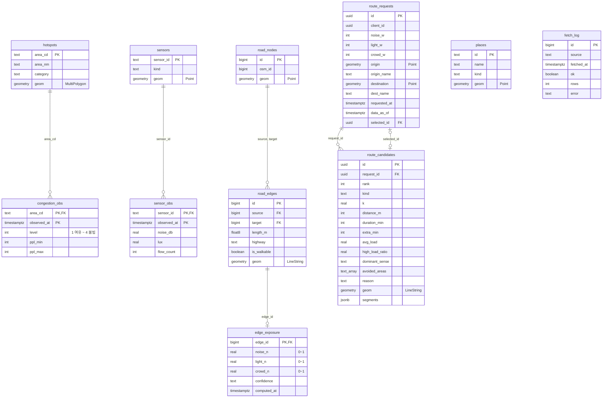

# Supabase (BE)

FE에 주는 함수의 인자와 응답 형식은 [docs/api.md](../docs/api.md)에 있습니다.

```
supabase/
├─ config.toml
├─ migrations/
│  ├─ 20261031074000_init_schema.sql  테이블 · 뷰 · RLS (원격 DB에 이미 있는 스키마를 옮겨 적은 것)
│  └─ 20261031074100_rpc_stubs.sql    계산 함수 + FE용 RPC (지금은 가짜 데이터)
└─ seed.sql
```

## DB에 적용하기

Docker 없이 원격 프로젝트에 바로 적용합니다. 처음 한 번만 로그인하고 프로젝트를 연결합니다(DB 비밀번호 필요).

```bash
npx supabase login
```

```bash
npx supabase link --project-ref oojowgovzmjlhzuqzqcp
```

테이블은 원격에 이미 만들어져 있으므로, 첫 마이그레이션은 실행하지 않고 "적용됨"으로 표시만 합니다. 처음 한 번만 합니다.

```bash
npx supabase migration repair --status applied 20261031074000
```

그다음부터는 push로 새 마이그레이션(지금은 RPC)만 적용합니다.

```bash
npx supabase db push
```

- `db push` 전에 `git pull`로 다른 사람의 마이그레이션을 먼저 받습니다. 원격 DB에 내 로컬에 없는 마이그레이션이 있으면 push가 거부됩니다.
- 변경은 항상 새 파일로 합니다(`npx supabase migration new <이름>`). 대시보드 SQL 편집기에서 직접 테이블을 바꾸면 레포와 DB가 어긋나니, 바꿨다면 같은 내용을 마이그레이션으로도 남깁니다.
- RPC를 실제 로직으로 바꿀 때는 새 마이그레이션에서 같은 이름·인자로 `create or replace function` 합니다. 인자를 바꾸면 FE 호출이 깨지니 [docs/api.md](../docs/api.md)도 같이 고칩니다.

## 권한

- 모든 테이블에 RLS가 켜져 있습니다. anon 직접 읽기는 `hotspots`, `places`, `congestion_obs`, `edge_exposure`만 허용합니다.
- 나머지 테이블을 읽는 실제 RPC는 `security definer`로 만듭니다(`data_status()` 참고). 쓰기는 `service_role` 키를 쓰는 수집기·스크립트만 합니다.
- `fetch_log`는 오류 원문에 서울 API 키가 섞일 수 있어 anon 직접 읽기를 차단합니다. 앱에는 `data_status()`가 오류 원문 없이 요약만 돌려줍니다.
- 서울 API 키는 Edge Function 시크릿(`npx supabase secrets set SEOUL_OPENAPI_KEY=...`)에만 둡니다.

## ERD

`places`·`sensors`·`hotspots`·`road_edges`는 외래키 대신 좌표(PostGIS 거리 계산)로 서로 연결됩니다. 좌표는 모두 `geometry(4326)`입니다.



`latest_congestion`은 `congestion_obs`에서 장소별 가장 최근 행만 보여주는 뷰입니다.

## 남은 일

- [x] 확장 켜기: `postgis`, `pgrouting`, `pg_cron`, `pg_net` (켜져 있음)
- [x] 마이그레이션 3개 원격 적용 + 기록 정리 완료 (`npx supabase migration list`로 확인)
- [ ] 고정 데이터 적재: `hotspots`, `sensors`, `places` (도로망은 적재 완료: 마포, 노드 12,485 · 구간 17,076)
- [ ] Edge Function 수집기: `congestion_obs`, `sensor_obs`에 upsert하고 `fetch_log`에 기록
- [ ] 정할 것: 혼잡도 예측(`best_times`용)을 저장할 테이블, 쉼터 운영시간 컬럼, `edge_exposure.confidence` 값 체계
- [ ] IDW 보간으로 `edge_exposure` 계산
- [ ] RPC 본문을 실제 로직으로 교체(`TODO(BE)` 주석): `nearby_shelters` → `place_detail` → `map_layers` → `best_times` → `quiet_routes`
